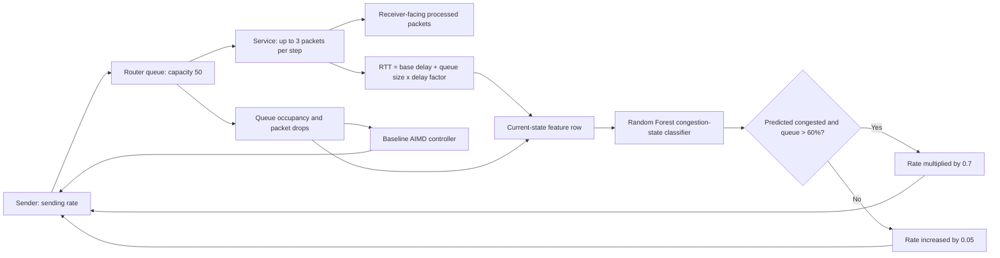

# Machine Learning-Based Predictive Congestion Control in TCP Networks

A small, reproducible Python project that compares a baseline AIMD congestion
controller with a Random Forest-assisted controller in a simulated packet
network. The model classifies the **current congestion state** from synthetic
simulation data; it does not predict a future congestion event.

> **Scope:** This is a custom, simplified TCP-like simulation. It does not
> modify, replace, or control the real TCP implementation in Windows or the
> Linux kernel.

## Problem statement

When offered traffic exceeds a router's service capacity, packets can queue,
round-trip time (RTT) can rise, and packets can be dropped. This project models
those effects and explores whether a classifier's congestion-state output can
be used as an alternate rate-control signal.

## Objectives

- Simulate a sender, a finite router queue, and a receiver-facing service rate.
- Generate labeled observations from a baseline additive-increase,
  multiplicative-decrease (AIMD) controller.
- Train and evaluate a Random Forest classifier on those observations.
- Compare baseline and ML-assisted RTT, packet loss, and throughput under the
  same simulation settings.
- Keep the experiment small enough to run and understand from a beginner-level
  Python environment.

## Key features

- Fixed, documented simulation settings shared by all scripts.
- CSV data generation with explicit feature and label column order.
- A held-out test split for a basic classifier evaluation.
- DataFrame-based prediction with the same named features used for training,
  avoiding scikit-learn feature-name warnings.
- Saved RTT charts in `outputs/` as well as interactive plot windows.
- Console summaries of packet loss and throughput.

## Networking concepts

- **TCP:** Transmission Control Protocol provides reliable, ordered byte-stream
  delivery and uses congestion control to share network capacity. This project
  imitates a few congestion-control ideas; it is not a TCP implementation.
- **Congestion control:** A sender adjusts how much data it injects into a
  network in response to congestion signals.
- **AIMD:** The baseline adds 0.05 to the sending-rate variable each step
  without a drop and halves it after a step with packet loss. The rate has a
  lower bound of 1 packet per step.
- **RTT:** Round-trip time is represented here by
  `base delay + queue size * delay factor`, with a base delay of 50 and delay
  factor of 2. These are simulation time units, not measured milliseconds.
- **Router queue:** The simulated queue can hold 50 packets and serves up to 3
  packets per simulation step.
- **Packet loss:** A packet is dropped when an arriving packet finds the queue
  already at capacity. Loss is counted per dropped packet.
- **Throughput:** Reported as successfully processed packets divided by the
  number of simulation steps. It is a simplified packet-per-step metric, not
  link bandwidth or application goodput.

## System architecture



## Simulation logic

Each of 5,000 steps:

1. The sender offers `int(sending_rate)` packets to the router queue.
2. Packets that arrive while the queue is full are dropped.
3. The router processes up to 3 queued packets.
4. RTT and RTT change are calculated from the queue remaining after service.
5. The simulator records RTT, RTT change, queue size, and the sending rate
   **before** the current step's rate adjustment.
6. The current congestion label is `1` only when the post-service queue size
   is strictly greater than 80% of capacity (greater than 40 packets for a
   capacity of 50).
7. In the baseline run, the sender applies AIMD. In the ML-assisted run, the
   model classifies that current observation; a positive prediction together
   with a queue size strictly greater than 60% of capacity triggers a 0.7
   multiplier. Otherwise the rate is increased by 0.05.

Both controllers use the same time-step count, queue capacity, service rate,
delay settings, starting rate, and queue state.

## Machine-learning methodology

The project uses `RandomForestClassifier` with 100 trees and `random_state=42`.
Random Forest combines decision trees and can model nonlinear feature
boundaries without requiring feature scaling, making it a straightforward
baseline for a small tabular classification exercise.

`ml_model.py` divides generated rows into training and test subsets with an
80/20 split and fixed random state. The simulation and `comparison.py` train on
all generated rows before their ML-assisted runs; those run results are
demonstrations, not independent model validation.

**Important limitation:** The label is derived directly from queue occupancy
(`Queue_Size > 40`), and `Queue_Size` is also a model input. The model is
therefore classifying a current state using an input that directly determines
the label. A high test accuracy does not independently establish reliable
prediction of future congestion. The random row split can also place nearby
observations from the same deterministic run in both subsets.

## Dataset

`network_data.csv` contains 5,000 observations with these columns in order:

| Column | Meaning |
|---|---|
| `RTT` | Simulated RTT after queue service |
| `RTT_Change` | Current RTT minus the previous step's RTT |
| `Queue_Size` | Number of packets remaining in the queue after service |
| `Sending_Rate` | Rate variable used for packet generation at the beginning of the step |
| `Label` | `1` when queue occupancy is strictly above 80% of capacity; otherwise `0` |

The CSV is small and useful for reproducibility, so it is included in the
project. Running `network_simulation.py` regenerates it deterministically from
the fixed settings.

## Project structure

```text
.
├── .gitignore
├── README.md
├── comparison.py
├── ml_model.py
├── ml_tcp_simulation.py
├── network_data.csv
├── network_simulation.py
├── requirements.txt
└── simulation_utils.py
```

`outputs/` is created when a script saves a chart. It is intentionally ignored
by Git because the charts can be regenerated. Save manually captured portfolio
screenshots under `screenshots/`; that directory is not ignored.

## Prerequisites and installation (Windows)

- Windows 10 or later
- Python 3.10 or later, available as `python` in the VS Code terminal
- VS Code (recommended, but not required)

Open the project folder in VS Code, then open **Terminal → New Terminal** and
run:

```powershell
python -m venv .venv
.\.venv\Scripts\Activate.ps1
python -m pip install --upgrade pip
python -m pip install -r requirements.txt
```

If PowerShell prevents virtual-environment activation, use the interpreter
directly instead:

```powershell
.\.venv\Scripts\python.exe -m pip install -r requirements.txt
```

## Run the scripts

Run these commands from the project folder in the VS Code terminal, in order:

```powershell
python network_simulation.py
python ml_model.py
python ml_tcp_simulation.py
python comparison.py
```

The first command generates or refreshes `network_data.csv` and saves
`outputs/network_simulation_rtt.png`. The classifier evaluation prints the
held-out metrics. The ML simulation saves
`outputs/ml_tcp_simulation_rtt.png`. The final script prints a same-settings
comparison and saves `outputs/rtt_comparison.png`. With an interactive
Matplotlib backend, each simulation script also opens its chart in a plot
window; close the window to continue in the terminal.

## Expected outputs and interpretation

- **Dataset generation:** reports row count, baseline packet loss, throughput,
  and the saved RTT chart path.
- **Model evaluation:** prints test accuracy, a confusion matrix (actual
  classes in rows; predicted classes in columns), and per-class precision,
  recall, and F1. Interpret these only as a basic split of this synthetic
  dataset, not as evidence of future-event prediction or real-network
  performance.
- **ML simulation:** reports packet loss and throughput for the model-assisted
  run and saves its RTT graph.
- **Comparison:** prints packet loss, throughput, and mean RTT for both
  controllers and plots RTT over simulation step. A lower RTT alone does not
  imply an overall improvement; consider loss and throughput too.

### Verified run results

The following values are from this project's local run using the commands
above; they are not target values and may vary with dependency/library
behavior:

| Measure | Verified value |
|---|---:|
| Generated dataset rows | 5,000 |
| Random Forest held-out test accuracy | 1.0000 (confusion matrix: `[[712, 0], [0, 288]]`) |
| Baseline packet loss / throughput | 103 packets / 2.988 packets per step |
| ML-assisted packet loss / throughput | 0 packets / 2.988 packets per step |
| Baseline / ML-assisted mean RTT | 124.019 / 110.922 simulation time units |

The 1.0000 test accuracy is expected to be easy to achieve here because
`Queue_Size` directly determines the label; it is not evidence of general
predictive performance. The figures above were produced with Python 3.14.3,
pandas 3.0.0, scikit-learn 1.8.0, and Matplotlib 3.10.8.

## Limitations and future improvements

- The simulation is deterministic and intentionally omits many real TCP,
  network, and router behaviors.
- RTT is an illustrative queue-based formula, not a packet-level measured
  round-trip time.
- The label describes current queue state rather than a future congestion
  event, and queue occupancy is itself a model feature.
- Randomly splitting consecutive observations can overstate generalization.
- More informative future work could use a time-based or separate-run test
  set, a future congestion label with a defined prediction horizon, varied
  traffic/network conditions, and comparison against additional controllers.
- Results should not be presented as real-network performance, a production
  congestion controller, or a claim of worldwide novelty.

## Technologies

- Python
- pandas for tabular data and CSV files
- scikit-learn for the Random Forest classifier and evaluation metrics
- Matplotlib for RTT plots

## References

- [RFC 5681: TCP Congestion Control](https://www.rfc-editor.org/rfc/rfc5681)
- [RFC 6298: Computing TCP's Retransmission Timer](https://www.rfc-editor.org/rfc/rfc6298)
- [Python documentation](https://docs.python.org/3/)
- [pandas documentation](https://pandas.pydata.org/docs/)
- [scikit-learn RandomForestClassifier documentation](https://scikit-learn.org/stable/modules/generated/sklearn.ensemble.RandomForestClassifier.html)
- [scikit-learn model evaluation documentation](https://scikit-learn.org/stable/modules/model_evaluation.html)
- [Matplotlib documentation](https://matplotlib.org/stable/)
